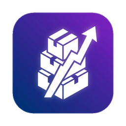

# Micro Stocker Advanced Pro

> Fully responsive **cross-platform desktop application** — Electron + React + TypeScript.
> Status: **foundation complete**, feature modules pending the business spec.



## What this repository currently is

A production-grade desktop-app skeleton you can actually run:

| Area | Delivered |
| --- | --- |
| **Responsive shell** | Sidebar ⇄ icon rail ⇄ drawer ⇄ bottom tab bar; tables collapse into cards; fluid `clamp()` typography; works from **360 px to 4K** |
| **Desktop runtime** | Electron 45 main process with sandboxed preload, secure IPC (files, dialogs, zoom, theme, external links), single-instance lock, native menu |
| **Data layer** | Offline key/value store (JSON files in `userData` on desktop, `localStorage` in browser) **plus** a Supabase cloud adapter with runtime credential entry, connection tester and generated SQL schema (incl. offline `sync_queue`) |
| **UI kit** | Buttons, cards, badges, fields, switches, segmented control, modal/bottom-sheet, tabs, responsive `DataTable` with sorting, stat cards, toasts, empty states, code block with copy |
| **Theming** | Light/dark/system, compact density, reduced motion, user UI-scale 60–200 % (`Ctrl +/-/0`), currency-aware formatting (BDT default) |
| **QA tooling** | Built-in **Responsive Lab**: live viewport readout, breakpoint ruler, real app rendered inside device-width frames (360/390/768/1024/1280/1600 px) |
| **Packaging** | electron-builder config for Windows NSIS installer + portable, macOS dmg, Linux AppImage/deb; GitHub Actions workflow builds and publishes real installers on tag push |

## Requirements

- **Node.js 20.19+ / 22.12+** (22 LTS recommended)
- npm 10+
- Optional: a [Supabase](https://supabase.com) project if you want cloud sync (the app runs fully offline without one)

## Quick start

```bash
npm install          # installs deps + Electron (~120 MB binary)
npm run dev          # Vite dev server + Electron window with hot reload
```

Other useful commands:

```bash
npm run dev:web      # renderer only in a browser — test on your phone over LAN
npm run verify       # type check + production build
npm run dist:win     # Windows installer   -> release/
npm run dist:mac     # macOS dmg           -> release/
npm run dist:linux   # AppImage + deb      -> release/
```

> The dev window opens with DevTools detached. Minimum window size is
> **360 × 560** on purpose — the layout is designed to stay usable down to phone width.

## Cloud (Supabase)

1. Create a project at supabase.com.
2. Open the app → **Cloud connection** → copy the SQL shown there into
   *Supabase Studio → SQL Editor* and run it (creates `app_meta`, `kv_store`,
   `sync_queue` + RLS policies).
3. Paste the **project URL** and the **anon public key** into the same screen and
   press **Save & connect**. The badge in the top bar turns green when reachable.

Alternatively bake them in at build time via `.env.local` (see `.env.example`).
**Never** put a `service_role` key in the desktop app.

Credentials are stored only on the local machine
(`userData/app-data/msap:cloud-config.json` on desktop, `localStorage` in preview).

## Getting real installers (without building here)

Installers are 100–300 MB, so they are produced by GitHub's runners using the
workflow template shipped at **`docs/ci/build-desktop-installers.yml`**.
The sandbox is not allowed to create files under `.github/workflows/`, so copy
that file into `.github/workflows/build.yml` once (via the GitHub web UI or a
local push — instructions are written at the top of the file). Then:

```bash
git tag v0.1.0 && git push origin v0.1.0
```

The workflow builds Windows/macOS/Linux artifacts and publishes a
**GitHub Release** with the `.exe`, `.dmg`, `.AppImage` and `.deb`.
You can also trigger it manually from the **Actions** tab.

## Project structure

```
electron/            main process (CJS, no build step) + sandboxed preload
  main.cjs           window, menus, secure IPC handlers, local file store
  preload.cjs        contextBridge -> window.desktop
src/
  App.tsx            HashRouter + providers (file:// safe routing)
  index.css          Tailwind v4 design tokens, light/dark, print, a11y
  components/
    layout/          AppShell, Sidebar, Topbar, MobileTabBar, PageHeader, Logo
    ui/              Button, Card, Badge, Field, Modal, Tabs, DataTable, …
  hooks/             useViewport, useMediaQuery (breakpoint logic)
  lib/               desktop bridge, kv store, formatters, cloud (Supabase)
  pages/             Overview, Cloud, ResponsiveLab, Settings, About, 404
  state/             AppProvider (settings/cloud/zoom), ToastProvider
resources/           app icons (png + ico) used by electron-builder
.github/workflows/   installer builds + GitHub Release publishing
```

## Responsive guarantees

| Width | Navigation | Content |
| --- | --- | --- |
| < 640 px | drawer + bottom tab bar | single column, dialogs = bottom sheets |
| 640–1023 px | drawer | 2-column grids, tables replace card lists |
| 1024–1279 px | auto-collapsed icon rail | 3-column dashboards |
| ≥ 1280 px | full labelled sidebar | dense multi-column workspace |
| ≥ 1536 px | full sidebar | extra columns instead of stretched content |

Everything is rem-based, so Windows display scaling (125 %/150 %) and the in-app
**UI scale** slider both reflow the layout instead of clipping it. Touch devices
automatically get 44 px minimum hit targets.

## Keyboard shortcuts

| Combo | Action |
| --- | --- |
| `Ctrl/⌘ K` | focus search |
| `Ctrl/⌘ B` | collapse/expand sidebar |
| `Ctrl/⌘ =` / `Ctrl/⌘ -` | UI scale up / down |
| `Ctrl/⌘ 0` | reset UI scale |
| `Esc` | close dialog / drawer |

## What comes next (blocked on the spec)

The business description of “Micro Stocker Advanced Pro” has not been provided
yet. Once it is, the first complete module (UI + local data + cloud sync +
tests) will be built here as the pattern for the rest.

## Licence

MIT — © 2026 pritamsarkar711
