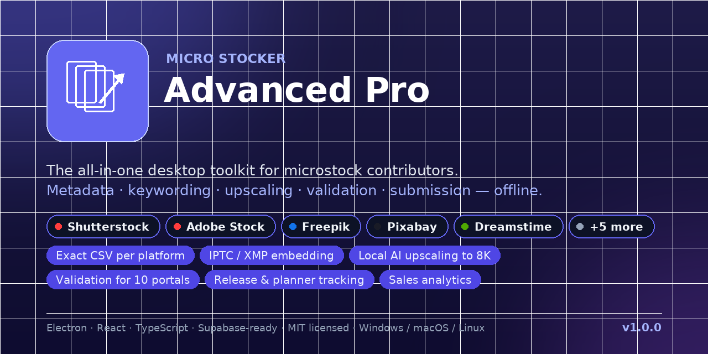

<div align="center">



# Micro Stocker Advanced Pro

**One desktop workspace for every microstock portal.**
Metadata, keywording, exact per-platform CSV, IPTC/XMP embedding, local AI
upscaling to 8K, validation, submission tracking and earnings analytics for
**14 marketplaces** — offline, on your own machine.

[](https://github.com/pritamsarkar711/Micro-Stocker-Advanced-Pro/releases)
[](#-supported-marketplaces)
[](#testing)
[](LICENSE)

[Download](#-download) · [Marketplaces](#-supported-marketplaces) · [Features](#-whats-inside) · [Build](#-build-from-source) · [Support](#-support)

</div>

---

## 📥 Download

Installers are published on the **[Releases page](https://github.com/pritamsarkar711/Micro-Stocker-Advanced-Pro/releases)**.

| Platform | File |
| --- | --- |
| Windows 10/11 (x64) | `Micro-Stocker-Advanced-Pro-Setup-<version>.exe` |
| Windows (no install) | `Micro-Stocker-Advanced-Pro-<version>.exe` (portable) |
| macOS (Apple silicon + Intel) | `.dmg` |
| Linux (x64) | `.AppImage` |

No account, no subscription, no telemetry, and **no paid AI required**. Download
once and the app runs fully offline; the only connections it ever makes are the
ones you start — the optional one-time Real-ESRGAN download, the optional
Supabase sync, and the AI provider you pick (none by default).

## 🌍 Supported marketplaces

Each card in the app carries the portal's own mark, its current limits, its CSV
dialect and its AI policy.

| Marketplace | Bulk CSV | Keywords | AI content |
| --- | --- | --- | --- |
| **Shutterstock** | ✅ comma + header | 7–50 | ❌ rejected |
| **Adobe Stock** | ✅ comma + header | 5–49 (ordered) | ✅ labelled |
| **Freepik / Magnific** | ✅ semicolon, single quotes, no header | up to 50 | ✅ labelled |
| **Pixabay** | copy sheet | ≤ 20 tags | portal rules |
| **Dreamstime** | ✅ comma + header | 7–50 | ✅ labelled |
| **123RF** | ✅ comma + header | 10–50 | ✅ labelled |
| **Depositphotos** | ✅ comma + header | ≥ 8 | ❌ rejected |
| **Vecteezy** | ✅ comma + header | 5–50 (first 5 weighted) | ✅ labelled |
| **Getty / iStock** | copy sheet | portal form | ❌ banned |
| **Alamy** | copy sheet | portal form | ❌ rejected |
| **Pond5** | ✅ comma + header | 5–50 | ❌ not accepted |
| **VectorStock** | preview IPTC only | up to 60 | ❌ vectors only |
| **Canva Creators** | ✅ comma + header | ≥ 5 (UI cap 20) | ✅ labelled |
| **Envato Elements** | author dashboard | ≤ 50 tags | ✅ labelled |

Values marked "portal form" have no CSV importer, so the app generates a
copy-paste sheet with the exact fields in the right order.

## ✨ What's inside

| Module | What it does |
| --- | --- |
| **Metadata AI** | Free by design, three routes: the built-in offline generator, a model on your own machine (Ollama or any OpenAI-compatible server), or a free-tier cloud key (OpenRouter, Gemini, Mistral, NVIDIA, Groq, Cerebras, Together). Live connection test, real error messages, keys stored locally. |
| **Library** | Import JPG, PNG, WebP, EPS, AI, SVG. Existing IPTC/XMP is read on import. Grid or list, search, format filters, batch generate, batch embed, metadata templates, near-duplicate scan (64-bit dHash), folder watching on desktop. |
| **Prepare** | Strip EXIF/GPS and Photoshop blocks, re-encode through sRGB to any portal's size budget, sanitise SVG (scripts, handlers, `@import`, editor namespaces) and report on EPS/AI internals (CMYK, live fonts, rasters, Illustrator version). |
| **Upscale** | Built-in resampler plus one-click Real-ESRGAN (BSD-3, commercial-safe) running locally on your GPU. Four commercially usable models, six researched targets up to 8K (7680×4320), tiled passes for big output. Images are never uploaded. |
| **Export** | Exact CSV dialects for every portal above, UTF-8 BOM, platform-safe renaming, batch embedding, planner hand-off, plus re-import of existing metadata CSVs. |
| **Platforms** | A dense reference for all 14 marketplaces: formats, resolution windows, file caps, keyword rules, title caps, CSV layout and AI policy. |
| **Planner** | Per-portal queues (todo → queued → submitted → accepted / rejected) with real publishing caps, including Freepik's first-batch window and monthly limit. |
| **Releases** | Model and property release registry with expiry tracking and per-file linking; validation warns when commercial work shows people without a release. |
| **Earnings** | Import each portal's sales CSV with automatic column detection, get one ledger, a monthly trend, per-platform totals and best sellers. |
| **Cloud** | Optional Supabase sync of metadata descriptors, plus a one-file JSON backup/restore of the whole workspace. |

## 🚀 Build from source

```bash
git clone https://github.com/pritamsarkar711/Micro-Stocker-Advanced-Pro.git
cd Micro-Stocker-Advanced-Pro
npm install

npm run dev        # Electron window + hot reload
npm run dev:web    # browser-only preview
npm run verify     # typecheck + 57 tests + production build
npm run dist:win   # Windows installer + portable exe into ./release
```

Node 20+ (22 recommended). Linux/macOS builds work with `npm run dist:linux`
and `npm run dist:mac`; a macOS `.dmg` needs to be produced on macOS.

## 🧪 Testing

```bash
npm test
```

The suite bundles the pure domain layer with esbuild and runs **57 assertions**
on Node: every CSV dialect, validators, the metadata engine, binary IPTC/XMP
round-trips through real PNG/JPEG/SVG/EPS fixtures, SVG/EPS analysis, sales
parsing, planner maths, and a completeness check that all 14 marketplaces carry
a brand mark, a colour and a workflow.

## 🏗 Architecture

```
electron/          main + preload (fs, dialogs, upscaler, folder watcher)
src/
  components/      design system (buttons, cards, tables, fields) + shell
  lib/stock/       platforms, csv, csvimport, validate, metadata, xmp, files,
                   categories, dupes, filedoctor, vectorcheck, sales,
                   submissions, sync + upscale/{models,engine,classic}
  state/           app, toast, library, bank, releases
  pages/           Overview, Library, Prepare, Export, Upscale, Platforms,
                   Planner, Releases, Earnings, Keywords, Cloud, Settings, About
tests/             runtime suite + binary fixtures
docs/              CI workflow template, user guide, assets
```

Renderer routes are code-split; the shell plus first page is ~150 kB gzipped.

## 🔒 Privacy

- Artwork is processed only on your machine — the upscaler is a local binary.
- Cloud sync stores descriptors (names, metadata, statuses), never pixels.
- No analytics, no telemetry, no accounts.

## 📄 Licence

**Source-available proprietary licence** — see [LICENSE](LICENSE).

- ✅ Install and use official builds, personally or commercially.
- ✅ Build from source for your own use, and contribute changes back.
- ❌ Redistribute, mirror, resell, rebrand or publish modified builds.
- ❌ Remove or alter copyright and licence notices.

Versions up to and including **v1.0.0** were released under MIT and remain
available under those terms for anyone who obtained them.

Marketplace names and logos are trademarks of their owners and appear only to
identify the portal a file is prepared for. This project is independent and is
not affiliated with, endorsed by or sponsored by any marketplace. Third-party
component licences are listed in [THIRD-PARTY-NOTICES.md](THIRD-PARTY-NOTICES.md).

## 💬 Support

- [User guide](docs/user-guide.md)
- [Open an issue](https://github.com/pritamsarkar711/Micro-Stocker-Advanced-Pro/issues)

<div align="center">

**Built for contributors, by a contributor.**

</div>
