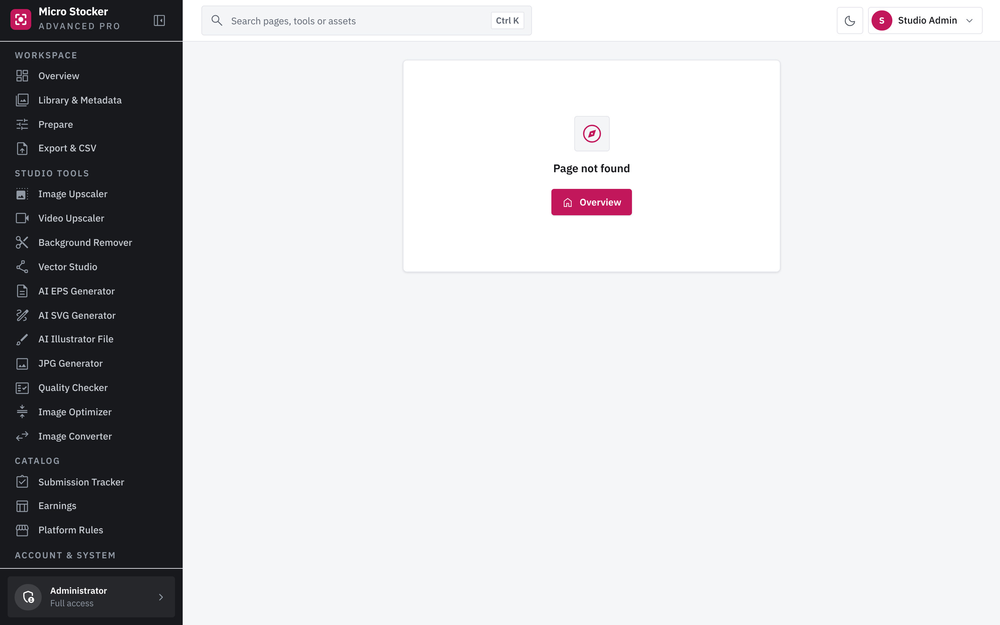
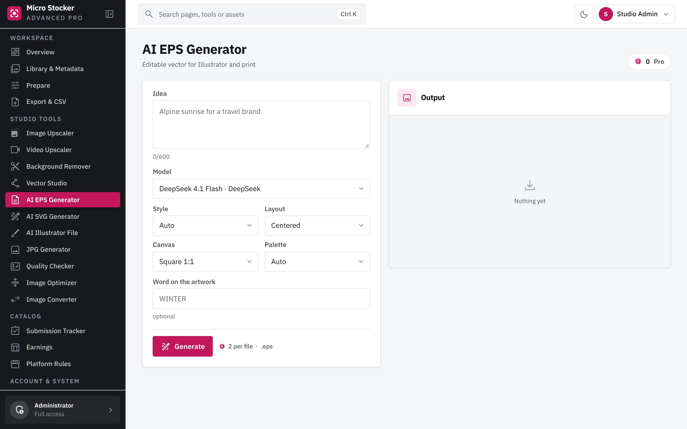
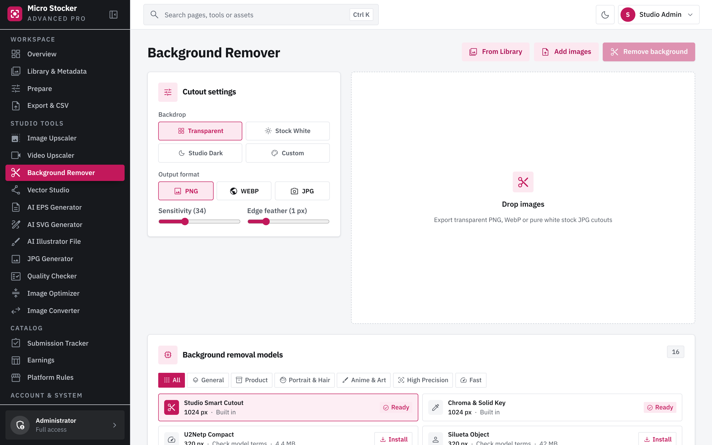
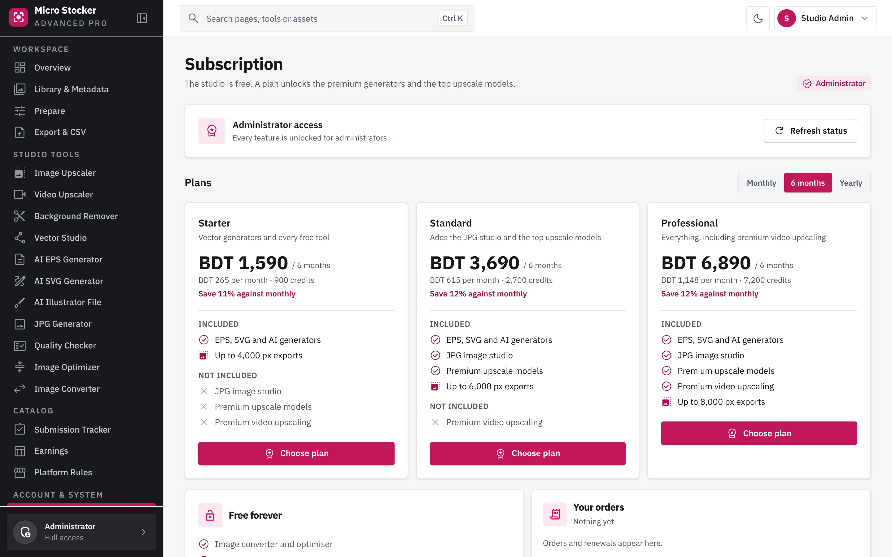
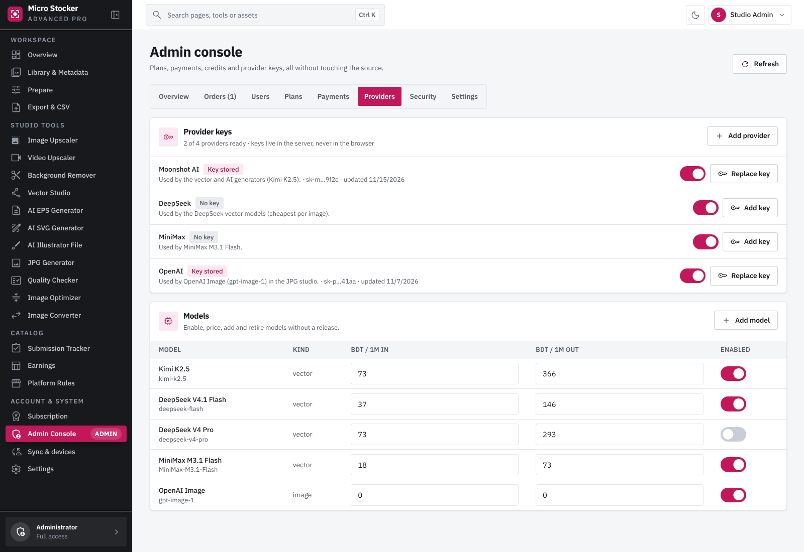

<div align="center">



# Micro Stocker Advanced Pro

**A complete microstock workspace for Windows, the browser and Android.**

Metadata, keywording, exact CSV for 14 marketplaces, IPTC and XMP embedding, local AI upscaling up to 8K, validation, submission tracking, earnings analytics and four AI art generators, all in one window.

[Download the latest release](https://github.com/pritamsarkar711/Micro-Stocker-Advanced-Pro/releases) · [Read the user guide](docs/user-guide.md) · [Report a problem](https://github.com/pritamsarkar711/Micro-Stocker-Advanced-Pro/issues)

</div>

## What it is

Micro Stocker Advanced Pro is built for people who sell images and vectors. It
reads what a picture actually contains, drafts a title and keywords from that
reading, writes the exact spreadsheet each marketplace expects, and keeps a
record of every submission. The heavy image work runs on your own machine, so a
large library does not depend on an internet connection.

## On a phone

The phone is the primary target, so the app starts like one. A cold start shows
the logo for a moment, then a welcome screen, then three short tour slides about
metadata, export and the studio tools. Registration or sign-in comes next, and the
dashboard only mounts once an account is ready. After that the splash goes
straight to the workspace.

The phone layout is its own shell rather than a squeezed desktop: an app bar that
names the page and opens a full-screen search, a five slot tab bar whose fifth
slot opens the full rail, page actions pinned above the tab bar, and controls
sized for a fingertip. The header, tab bar, drawer and sheets all pad for the
notch and the home indicator, and landscape shortens the bar without dropping its
labels. The metadata editor opens as a bottom sheet, wide tables scroll inside
their own card, and every marketplace row shows its full name.

## Screens

**AI EPS Generator.** Type an idea, choose a model, get editable vector output.



**Background Remover.** Local cutout with a full resolution erase and restore mask.



**Subscription.** Clear plans with the included and excluded features side by side.



**Admin console.** Providers, keys, model prices and plans change without a release.



## Everything inside

| Module | What it does |
| --- | --- |
| Image understanding | Every upload is decoded and measured in the app: scene type, palette with colour names, subject placement, flat colour regions, text layout, transparency, sharpness, noise, exposure, clipping and colour range. Runs offline and feeds the suggestions below. |
| Metadata AI | Three routes, one output: the built in offline generator, a model on your own machine through Ollama or any OpenAI compatible server, or a free cloud key. Live connection test and local key storage. |
| Library | JPG, PNG, WebP, EPS, AI and SVG import with existing IPTC and XMP read on arrival. Grid or list, search, format filters, batch generate, batch embed, metadata templates, near duplicate scan and folder watching. |
| Prepare | Strip EXIF, GPS and Photoshop blocks, re-encode through sRGB to a size budget, sanitise SVG and inspect EPS and AI internals such as CMYK, live fonts and embedded rasters. |
| Vector Studio | A full illustration editor with 11 drawing tools, 174 ready elements, editable templates, snapping guides, layer search, 80 step undo and export to sanitised SVG, vector EPS or an Illustrator compatible AI file. |
| Quality Checker | Scores artwork before upload: vector editability, sharpness, detail density, clipping, colour cast, grain, compression, transparency inside JPEG, file weight and near duplicates, with a per agency verdict. |
| Image Optimizer | Re-encodes to JPEG, WebP, AVIF or PNG at a visually lossless sweet spot or an exact KB target. Flat artwork often drops by 70 to 90 percent with no visible loss. |
| Image Upscaler | Built in resampling plus local neural models, with the model, preset and format recommended from the image itself. |
| Video Upscaler | Frame accurate upscaling to 4K and 8K with a progress panel and a preview before export. |
| Background Remover | Built in cutout, sixteen local models including BiRefNet and ISNet, and a mask editor for hair and product edges. |
| Four AI generators | AI EPS, AI SVG, AI Illustrator and JPG. DeepSeek, Gemini and MiniMax models, chosen per job, charged in credits. |
| Export | Exact CSV dialects for every marketplace, UTF 8 BOM, platform safe renaming, batch embedding and re-import of existing metadata sheets. |
| Planner | Per portal queues with real publishing caps, including first batch windows and monthly limits. |
| Releases | Model and property release registry with expiry tracking, linked per file. |
| Earnings | Import each portal sales CSV with automatic column detection and get one ledger, a monthly trend and best sellers. |
| Admin console | Plans, prices, orders, users, provider keys, new providers and models, crypto wallets and audit log, all without touching the source. |
| Sync | Accounts, subscriptions, credits, settings and workspace data follow you between devices. Pixels stay on the device that made them. |

## Supported marketplaces

| Marketplace | Bulk CSV | Keywords | AI content |
| --- | --- | --- | --- |
| Shutterstock | comma with header | 7 to 50 | rejected |
| Adobe Stock | comma with header | 5 to 49, ordered | labelled |
| Magnific (ex Freepik) | semicolon, single quotes, no header | up to 50 | labelled |
| Pixabay | copy sheet | 20 tags | portal rules |
| Dreamstime | comma with header | 7 to 50 | labelled |
| 123RF | comma with header | 10 to 50 | labelled |
| Depositphotos | comma with header | 8 or more | rejected |
| Vecteezy | comma with header | 5 to 50, first 5 weighted | labelled |
| Getty and iStock | copy sheet | portal form | banned |
| Alamy | copy sheet | portal form | rejected |
| Pond5 | comma with header | 5 to 50 | not accepted |
| VectorStock | preview IPTC only | up to 60 | vectors only |
| Canva Creators | comma with header | 5 or more | labelled |
| Envato Elements | author dashboard | up to 50 tags | labelled |

## Plans

Prices are in BDT and set for buyers in Bangladesh. Every plan includes the free
tools, the library, the planner and every marketplace export. Credits are spent
by the four generators only.

| Plan | 1 month | 6 months | 12 months | Credits each month |
| --- | --- | --- | --- | --- |
| Starter | 299 | 1,590 | 2,690 | 150 |
| Standard | 699 | 3,690 | 6,290 | 450 |
| Professional | 1,299 | 6,890 | 11,690 | 1,200 |

**Always free, no account needed:** converter, optimiser, background remover with
the built in engine and standard upscale models, Vector Studio and the metadata
workspace.

**Included by plan:**

| Feature | Starter | Standard | Professional |
| --- | --- | --- | --- |
| AI EPS, AI SVG and AI Illustrator generators | yes | yes | yes |
| JPG studio | no | yes | yes |
| Premium background and upscale models | no | yes | yes |
| Premium video upscaling to 4K and 8K | no | no | yes |
| Maximum export size | 4,000 px | 6,000 px | 8,000 px |

**Never included, on any plan:** offline bulk processing of someone else's
library, resale of generated files as a service, and any use that breaks a
marketplace AI policy.

Premium background, upscale and video models need an active plan and use no
credits. Credits are charged only by the AI EPS, AI SVG, AI Illustrator and JPG
generators, two credits for a vector file and eight for a JPG render.

## Paying

bKash and Nagad use the standard flow: send the amount to the number shown at
checkout, submit the transaction ID and the plan activates as soon as the
payment is approved in the admin console.

Crypto invoices take USDT, USDC, DAI and BNB on BNB Smart Chain, Polygon, Tron
and Solana. The checkout shows a coin and network, an address and the exact
amount, and a copy button for each. Payment is detected on chain: the verifier
compares the destination, network, amount and confirmation count, rejects any
transaction that was already used or that predates the invoice, and activates the
plan without a human in the loop. A scheduled scan keeps checking open invoices
every five minutes.

## Download and install

Grab the installer from the [Releases page](https://github.com/pritamsarkar711/Micro-Stocker-Advanced-Pro/releases).
Windows builds are unsigned unless the release notes say otherwise. Every build
talks to the same backend, so one account, one subscription and one credit
balance cover the desktop app, the web app and the phone.

**Android.** Each release carries an APK built from the same bundle. Install it on
the phone, sign in with the account you already use, and the library, presets and
credits are already there. Files you export are written to Documents and offered
through the share sheet, so a design can go straight to Drive or a chat app. The
phone build is produced by the Android workflow in this repository, which runs on
every version tag.

## Build from source

```bash
git clone https://github.com/pritamsarkar711/Micro-Stocker-Advanced-Pro.git
cd Micro-Stocker-Advanced-Pro
npm install

npm run dev        # desktop window with hot reload
npm run dev:web    # browser preview
npm run verify     # typecheck, tests and production build
npm run dist:win   # Windows installer and portable build
```

Node 20 or newer, 22 recommended. Linux and macOS builds use `npm run dist:linux`
and `npm run dist:mac`; a macOS disk image has to be produced on macOS.

## Tests and audits

```bash
npm test               # unit and integration suite, plus licensing SQL
npm run test:browser   # auth gate, mask editor and video encoder in Chromium
npm run qa:deep        # 24 routes at 10 widths: overflow, clipping, overlap, tap targets
npm run qa:a11y        # axe core, WCAG 2.1 AA, light and dark
npm run qa:contrast    # token contrast pairs
npm run qa:security    # two step verification, password change, sign in challenge
npm run qa:mobile      # four phone and tablet sizes across every route
npm run qa:launch      # splash, welcome, tour, registration, dashboard
```

The interface audits need the renderer running with `npm run dev:renderer` and
`VITE_DEMO_MODE=1`.

## Privacy and security

Image and video tools process artwork on your machine and pixels never leave it.
Accounts, subscriptions, credits and workspace metadata are stored in a Postgres
database with row level security, and every write goes through a security definer
function that decides what the caller may do. Provider keys live in server side
secrets, never in the app.

## Licence

Proprietary, all rights reserved. See [LICENSE](LICENSE).

* You may install and use official builds for your own work, including paid work.
* You may read the source and send improvements back as pull requests.
* You may not copy, clone, mirror, redistribute, resell, rebrand or publish this
  project or a modified version of it.

Versions up to and including v1.0.0 were published under the MIT licence and stay
available under those terms for anyone who received them.

Marketplace names and logos belong to their owners and appear here only to
identify the portal a file is prepared for. This project is independent and is
not affiliated with, endorsed by or sponsored by any marketplace. Third party
component licences are listed in [THIRD-PARTY-NOTICES.md](THIRD-PARTY-NOTICES.md).

## Support

Read the [user guide](docs/user-guide.md), review [SECURITY.md](docs/SECURITY.md)
for the security policy, or [open an issue](https://github.com/pritamsarkar711/Micro-Stocker-Advanced-Pro/issues).
